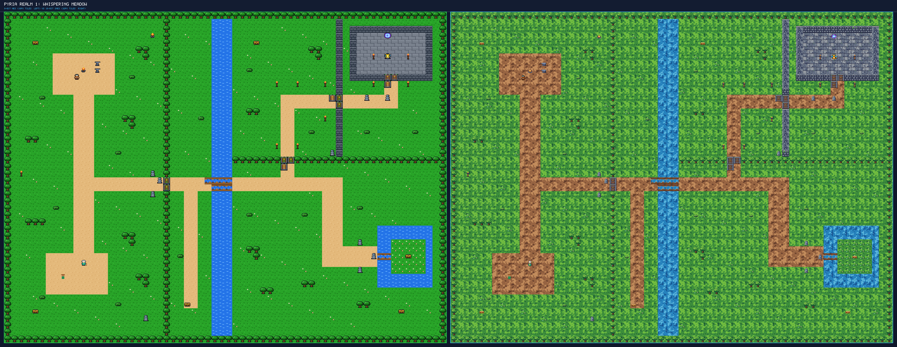

# Pyria: Return of the Bits

**Pyria** is a browser-based Python-learning RPG designed for a 10-year-old adventurer. Lord Null has drained the magical world of Pyria down to flat 8-bit pixels and caged its guardian dragons. As the young **Code-Tamer**—joined by **Pip**, a tiny glitch-hatchling dragon sidekick—you write real Python code to solve dungeon puzzles, rescue dragons, earn **Byte Shards**, and watch the entire game evolve across video game eras: **8-Bit NES → 16-Bit SNES → 3D**.



---

## Core Mechanics

- **Era → Realm → Trial Hierarchy (`N` Realms per Era)**
  - **The 8-Bit Era (*The Flatlands of Pixels*)**: **8 Realms**, 1 Dragon rescued per Realm. Each rescued Dragon restores **1 Bit** and triggers a mini visual upgrade (swaying grass, cliff shading, glowing torchlight, snowflakes, animated water, drifting clouds). Rescuing all 8 upgrades Pyria into the **16-Bit Era**.
  - **The 16-Bit Era (*The Sunken Isles & Beyond*)**: **16 Realms** organized into **4 Acts of 4 Realms** (Tideglass Archipelago, Clockwork Spire, Alchemist's Caldera, Shattered Skyway) introducing lists, `while` loops, functions (`def`/`return`), dictionaries, nested loops, and intro classes.
- **Python-Powered Character Creation**: Forge your hero by running real Python calls (`set_name()`, `preview_skin()`, `preview_hair()`, `preview_tunic()`, `confirm_hero()`).
- **Byte Shards & Bram's Workshop**: Earn **Byte Shards** from Trials and hidden chests, then spend them in Bram's Workshop by writing Python function calls (`wear_hat("explorer")`, `set_tunic_color("crimson")`, `equip_shield("oak")`, `add_charisma(1)`) to make real RPG gear and stat trade-offs.
- **Pip's 3-Tier Help System**: Every Trial includes 3 progressive hints (`tier1_nudge`, `tier2_pattern`, `tier3_walkthrough`) plus kid-friendly Python error translations that progressively reveal real Python tracebacks in later Realms.


---

## Repository Structure

```text
pyria/
├── docs/          # Game design blueprint & architecture docs
├── content/       # Data-driven JSON curriculum, economy & tilemaps
│   ├── game.json          # Metadata, NPCs, difficulty overrides & conceptProgression
│   ├── catalog.json       # Python character creation & Byte Shard unlockables
│   ├── schema.json        # JSON Schema + Python OUTPUT test harness convention
│   ├── eras/              # era-01-8bit.json (8 Realms) & era-02-16bit.json (16 Realms)
│   └── maps/              # 64x48 Zelda-style Realm tilemaps (Realms 1–6)
├── assets/        # Visual art, deterministic pixel-art generators & previewers
│   ├── concept-art/       # Key concept art renders & sprite dimension specs
│   ├── sprites/           # Modular 8-bit/16-bit Hero + Pip generator & preview.html
│   ├── tilesets/          # 8-bit/16-bit meadow & ruins tilesets + NPC/Dragon sheets
│   └── world/             # Interactive walkable world previewer & 8-bit/16-bit comparison
├── server/        # Zero-dependency Python 3 + SQLite backend (local dev & elzar deploy)
└── web/           # Playable browser RPG (HTML5 Canvas + Pyodide) & native /builder Admin Console
```

---

## Quick Start

### 1. Run the Game Locally
Start the zero-dependency Python 3 + SQLite server from the repository root:

```bash
python3 server/app.py --host 127.0.0.1 --port 8080
```

Then open [http://127.0.0.1:8080](http://127.0.0.1:8080) in your browser to create your hero, explore Whispering Meadow, and cast Python spells in-browser via Pyodide.

### 2. Regenerate Deterministic Sprites & Tilesets
All modular pixel-art sprites and tilesets are generated with pure Python 3 stdlib (`zlib`/`struct`, zero external dependencies):

```bash
python3 assets/sprites/build_sprites.py
python3 assets/tilesets/build_tilesets.py
```

You can also open `assets/sprites/preview.html` or `assets/world/preview.html` directly in a browser to inspect hero customization layers or walk around Realms 1 & 2 with live 8-Bit ↔ 16-Bit switching.

### 3. Open the Native Parent & Builder Console (`/builder`)
Visit [http://127.0.0.1:8080/builder](http://127.0.0.1:8080/builder) (or `https://<your-tunnel>/builder` on `elzar`) for the admin-only **Pyria Parent & Builder Console**:
- **Live Progress Stream**: Real-time activity feed with expandable Python code viewer, Hero progress cards, Account Switcher, and interactive `64×48` Realm Map Tracker with one-click Trial overrides (`✓ Mark Done` / `↺ Reset`).
- **Story & Trials**: Edit Eras, Realms, Trials, Pip hints, and run sandboxed Python solution tests.
- **Concept Health & Overrides**: Anti-repetition concept checks and global/per-Realm difficulty overrides.
- **Sprites & World**: Embedded Sprite Studio and Walkable World Map previewers.

### 4. Deploy to `elzar`
Production deployment helpers for `elzar` live under `server/`:

- `server/pyria.service` — Lingering user `systemd` unit running `server/app.py` on `127.0.0.1:8000` backed by `~/.local/share/pyria/pyria.sqlite3` with Cloudflare Access per-user auth (`PYRIA_ADMIN_EMAILS`).
- `server/deploy_elzar.sh` — Deploy script syncing to `elzar:~/pyria` and restarting `pyria.service` (`./server/deploy_elzar.sh --restart`).

See [server/README.md](server/README.md) for full `elzar` setup and Cloudflare Tunnel details.

---

## Documentation

- [Game Design Blueprint](docs/game_design_blueprint.md) — Narrative arc, Era/Realm/Trial progression, economy, and UX architecture
- [Concept Art & Sprite Specs](assets/concept-art/README.md) — Visual targets, 8-bit (`16x16`) & 16-bit (`32x32`) dimensions, and modular Z-layer order
- [Server & Deployment Guide](server/README.md) — Local server options, SQLite save API, tests, and `elzar` deployment
