# Pyria: Return of the Bits

**Pyria** is a browser-based Python-learning RPG designed for a 10-year-old adventurer. Lord Null has drained the magical world of Pyria down to flat 8-bit pixels and caged its guardian dragons inside **Logic Vaults**. As the young **Code-Tamer**—joined by **Pip**, a tiny glitch-hatchling dragon sidekick—you write real Python 3 (running safely in-browser via **Pyodide** WebAssembly) to solve dungeon trials, rescue **36 Dragon Guardians**, earn **Byte Shards**, uncover hidden bonus rounds and Easter eggs, and watch the entire game evolve across video game history:

**8-Bit NES → 16-Bit SNES → 32-Bit PS1/GBA Isometric 2.5D → 64-Bit Nintendo 64 3D** *(with concept roadmap through 128-Bit, HD, and Modern 4K Sandbox!)*

---

## Live Gameplay Across All 4 Playable Eras

| **1. 8-Bit Era (NES 2D)** — *Whispering Meadow* | **2. 16-Bit Era (SNES 2D)** — *Coral Shallows* |
| :---: | :---: |
| 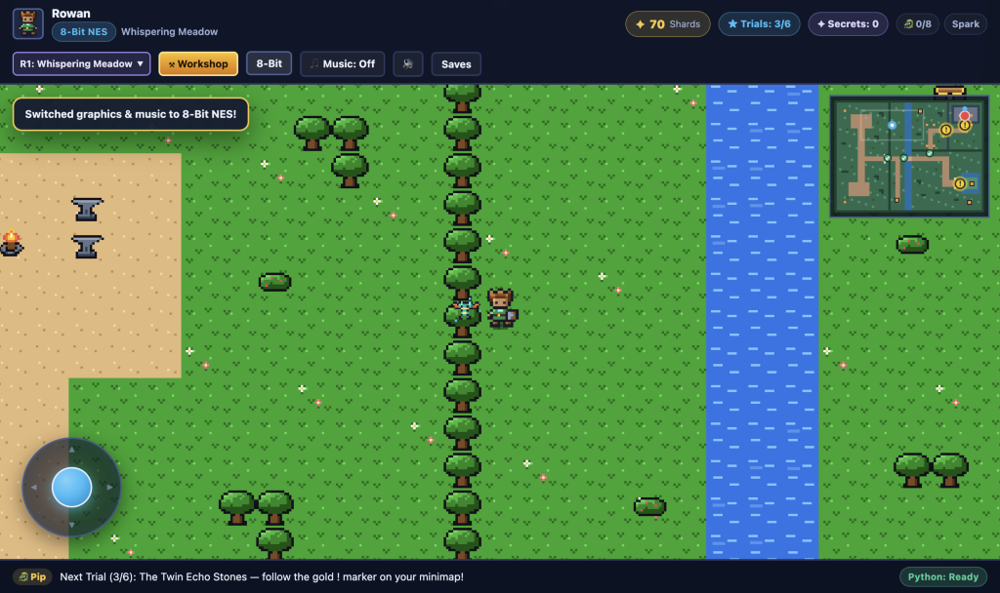 | 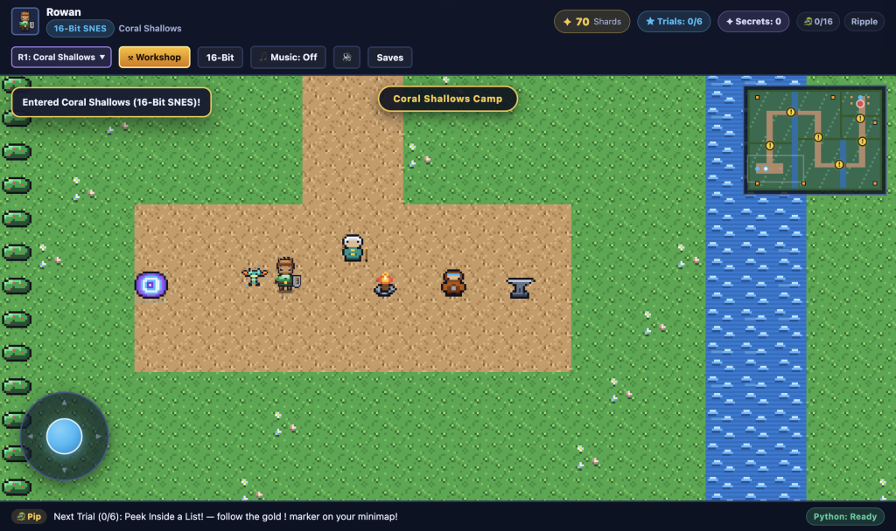 |
| **3. 32-Bit Era (PS1 / GBA Isometric 2.5D)** — *Blockstone Highlands* | **4. 64-Bit Era (Nintendo 64 Gouraud 3D)** — *Polygon Valley* |
| 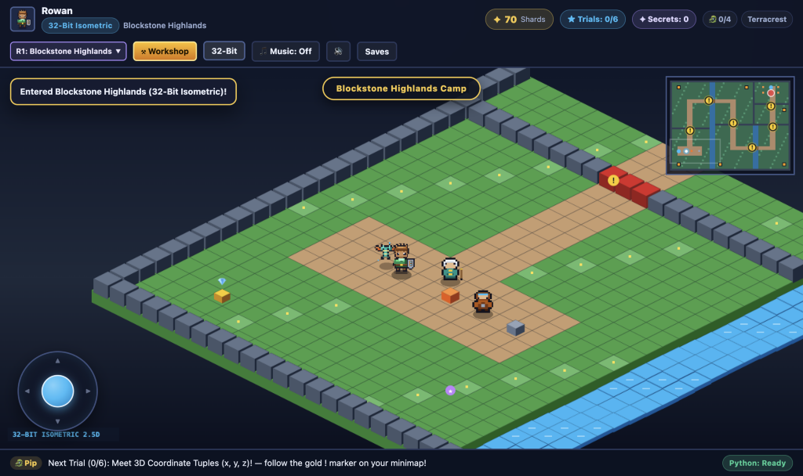 | 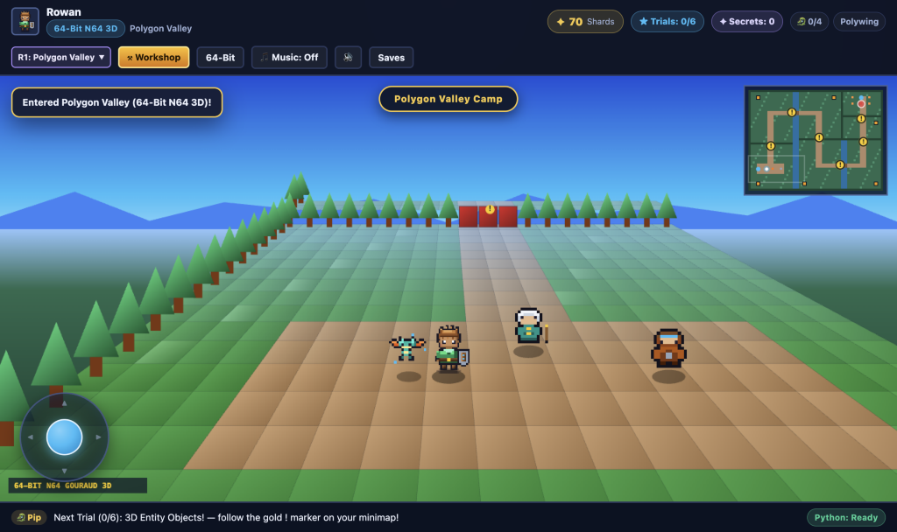 |

---

## The 4 Playable Eras & 36 Realms (`310 Trials`)

Every single Realm follows a **slow-growth scaffolded cadence** so new concepts never feel like a cliff:
1. **Multiple Choice (`Predict & Choose`)** — Read real Python and predict the output or spot valid syntax first.
2. **Fix the Bug (`🐛`)** — Repair one targeted sabotage from Lord Null (missing quotes, colons `:`, 4-space indentation, `=` vs `==`, etc.).
3. **Guided Coding Trials (4 steps)** — Build up gradually from Explorer/Standard/Challenge starters to the **Realm Boss Trial** with pre-boss and post-boss **Cutscenes**.
4. **Hidden Bonus Trial & 2 Easter Eggs** — Explore off the main path to unlock free Personal Kit gear and earn **+1 Bonus Hint** (unlocking Pip's Tier 4 Secret Solution Guide).

---

### Era 1: The 8-Bit Era — *The Flatlands of Pixels* (NES · 8 Realms · 83 Trials)
*Early Realms 1–3 use friendly `say()` and `shout()` training spells before graduating to real `print()` in Realm 4. Rescuing all 8 Dragons restores all 8 Bits and upgrades Pyria to 16-Bit SNES!*

| # | Realm | Dragon Guardian | Python Focus | Mini World Upgrade |
| :-: | :--- | :--- | :--- | :--- |
| **1** | **Whispering Meadow** | **Spark** *(Lightning)* | `say()`, `shout()`, strings & string joining (`+`) | Swaying meadow grass & firefly pixels |
| **2** | **Mossy Ruins** | **Pebble** *(Earth)* | Variables (number & word boxes), basic math (`+`, `*`) | Shaded cliff edges & ruin dust particles |
| **3** | **Cinder Cavern** | **Emberwing** *(Fire)* | Booleans, `:` colons, 4-space indentation, `=` vs `==`, `if` / `else` | Flickering torchlight & rising embers |
| **4** | **Frostbite Hollow** | **Glacier** *(Ice)* | Graduating to `print()`, `if` / `elif` / `else` branching | Falling pixel snowflakes & ice highlights |
| **5** | **Echo Woods** | **Bramble** *(Forest)* | Logical operators (`and`, `or`, `not`) & string methods (`.strip()`, `.upper()`) | Swaying forest canopy & glowing wisps |
| **6** | **Sunken Crypt** | **Mire** *(Water)* | Multi-branch conditionals, math & string cleanup combined, `str()` to glue text onto numbers | Rippling water & misty crypt spores |
| **7** | **Obsidian Keep** | **Gale** *(Wind)* | `for` loops & `range()` | Drifting sky-clouds & wind trails |
| **8** | **Null's Pixel Citadel** | **Nova** *(Starlight)* | 8-Bit Era Capstone (loops + conditionals + modulo `%` + strings) | **All 8 Bits Restored → Upgrades to 16-Bit SNES!** |


---

### Era 2: The 16-Bit Era — *The Sunken Isles & Beyond* (SNES · 4 Acts · 16 Realms · 128 Trials)
*Organized into 4 themed Acts of 4 Realms each, with lush 16-bit SNES pixel art and multi-voice synth music:*

| Act | Realms (1–16) | Dragons | Python Focus |
| :--- | :--- | :--- | :--- |
| **Act I — Tideglass Archipelago** | 1. Coral Shallows · 2. Driftwood Market · 3. Pearl Grotto · 4. Maelstrom Lighthouse | Ripple, Gullwing, Nacre, Tempest | Lists (`[...]`), zero-based & negative indexing, `.append()`, `len()`/`max()`/`min()`/`sum()`, `/` division & floats, slicing, `for` over lists & filtering |
| **Act II — Clockwork Spire** | 5. Brass Courtyard · 6. Pendulum Halls · 7. Steam Foundry · 8. Grand Chronometer | Sprocket, Tock, Piston, Aether | `while` loops, `break` & `continue`, defining functions (`def`), parameters, default arguments & `return` |
| **Act III — Alchemist's Caldera** | 9. Sulfur Terrace · 10. Crystal Alembic · 11. Potion Vault · 12. Magma Core | Cinderel, Prism, Elixir, Crucible | Dictionaries (`{...}`), `.get()`, `.values()`, f-strings (`f"{...}"`), lists of dictionaries & frequency counting |
| **Act IV — Shattered Skyway** | 13. Cloud Dock · 14. Starlight Bridge · 15. Storm Bastion · 16. Null's 16-Bit Throne | Nimbus, Comet, Fulmin, Zenith | Nested loops & 2D grids, intro Classes (`class`, `__init__`, `self`, methods), object lists & **16-Bit Finale → Upgrades to 32-Bit Isometric!** |

---

### Era 3: The 32-Bit Era — *The Isometric Frontier* (PS1 / GBA 2.5D · 6 Realms · 51 Trials)
*Pyria tilts into an **Isometric 2.5D Diorama** with elevated terrain terraces (`elevation` heightmaps), extruded 3D stone blocks, and crystalline 32-bit synth music:*

| # | Realm | Dragon Guardian | Python Focus |
| :-: | :--- | :--- | :--- |
| **1** | **Blockstone Highlands** | **Terracrest** *(Earth)* | Tuples `(x, y, z)`, tuple unpacking, 3D elevation math |
| **2** | **Sky-Forge Foundry** | **Anvilwing** *(Fire)* | List comprehensions (`[x * 2 for x in ... if ...]`) & 2D/3D coordinate grids |
| **3** | **Prism Caverns** | **Lumina** *(Light)* | Sets (`set()`, `&` intersection, `|` union) & nested dictionary maps |
| **4** | **The Crystal Archives** | **Chronis** *(Crystal)* | Nested dictionaries (`rooms["hall"]["gems"]`), updating & adding inner keys, `.values()` / `.items()` loops |
| **5** | **Shieldwall Bastion** | **Aegis** *(Prism)* | Error shields: `try` / `except ValueError` / `KeyError` / `ZeroDivisionError` with safe fallbacks |
| **6** | **Null's Polygon Citadel** | **Vortex** *(Gravity)* | Error handling (`try` / `except`), safe parsers, 3D distance & **32-Bit Finale → Upgrades to 64-Bit N64 3D!** |

| Blockstone Highlands | Sky-Forge Foundry | Prism Caverns | Null's Polygon Citadel |
| :---: | :---: | :---: | :---: |
| 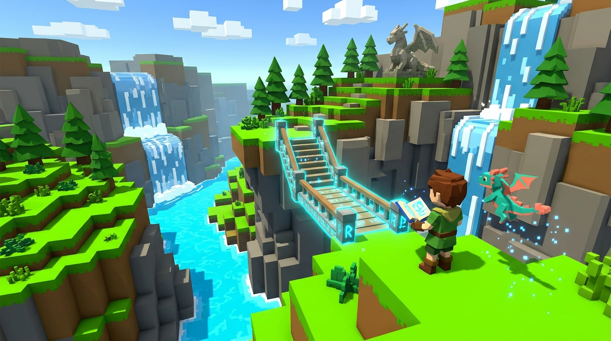 | 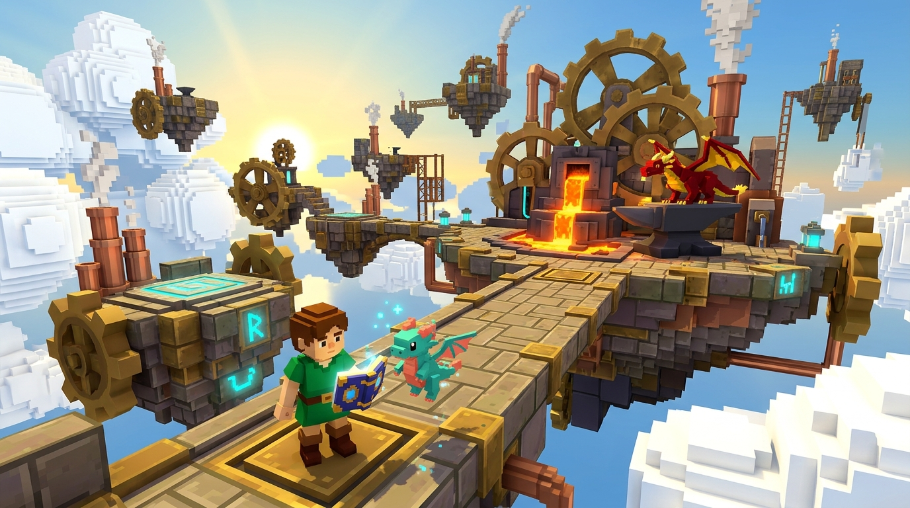 | 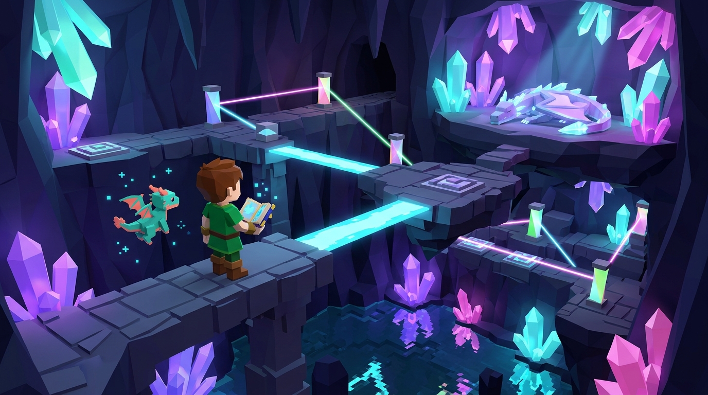 | 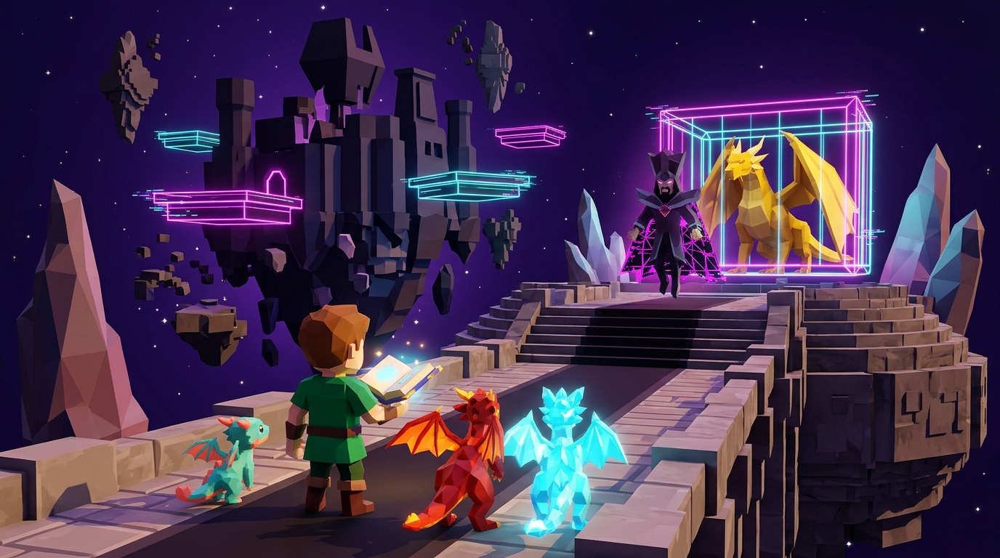 |

---

### Era 4: The 64-Bit Era — *The Nintendo 64 Realm of Polygons* (N64 3D · 6 Realms · 48 Trials)
*Pyria bursts into chunky **Nintendo 64 Gouraud-shaded perspective 3D** with a 3rd-person follow camera, cobalt skies, distant low-poly mountains, distance fog, and N64 orchestral synth music:*

| # | Realm | Dragon Guardian | Python Focus |
| :-: | :--- | :--- | :--- |
| **1** | **Polygon Valley** | **Polywing** *(Sky)* | 3D Entity Classes (`class Hero3D`, `__str__`, camera & movement methods) |
| **2** | **Gouraud Courtyard** | **Vertex** *(Stone)* | Class Inheritance (`class Sub(Parent):`), `super().__init__()`, method overrides & polymorphism |
| **3** | **Poly-Forge Arena** | **Vector** *(Light)* | Object composition (a `Scene` holding entities), polymorphic `.tick()` / `.draw()` loops & 3D volume methods |
| **4** | **Clockwork Testing Lab** | **Verify** *(Lightning)* | `assert` self-tests, off-by-one bugs, empty-list edge cases & clamping |
| **5** | **Star-Mesh Observatory** | **Quasar** *(Starlight)* | Debugging off-by-one bugs, `assert` self-tests, `sorted(..., key=lambda ...)` Painter's Algorithm |
| **6** | **Null's 64-Bit Sanctum** | **Aurelion** *(Crown)* | **Grand 64-Bit Boss Gauntlet** combining Classes, 3D Paths, Sorting & Error Shields to claim the **64-Bit Crown!** |

---

## Visual Concept Roadmap (8-Bit NES → Modern 4K)

Pyria's long-term visual ladder spans 7 eras of video game history (see [docs/game_design_blueprint.md](docs/game_design_blueprint.md)):

| 8-Bit NES | 16-Bit SNES | 32-Bit PS1/GBA | 64-Bit N64 |
| :---: | :---: | :---: | :---: |
| 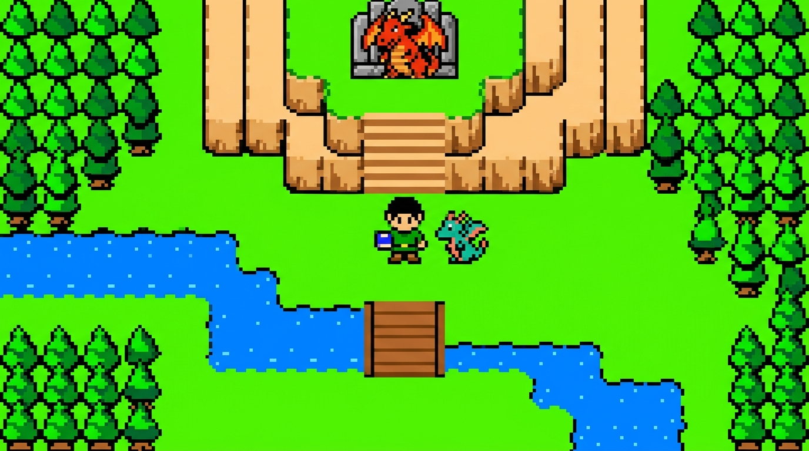 | 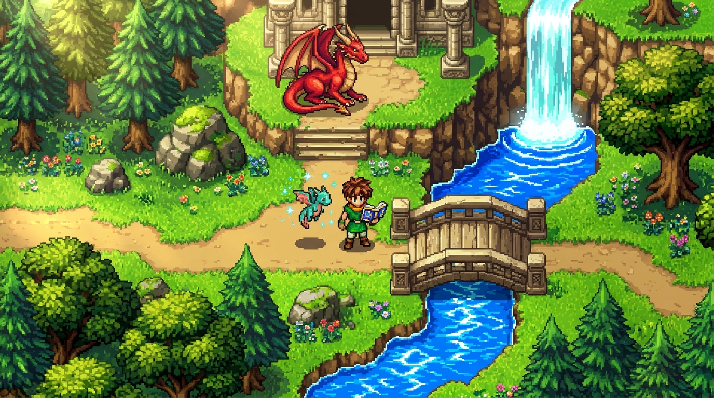 | 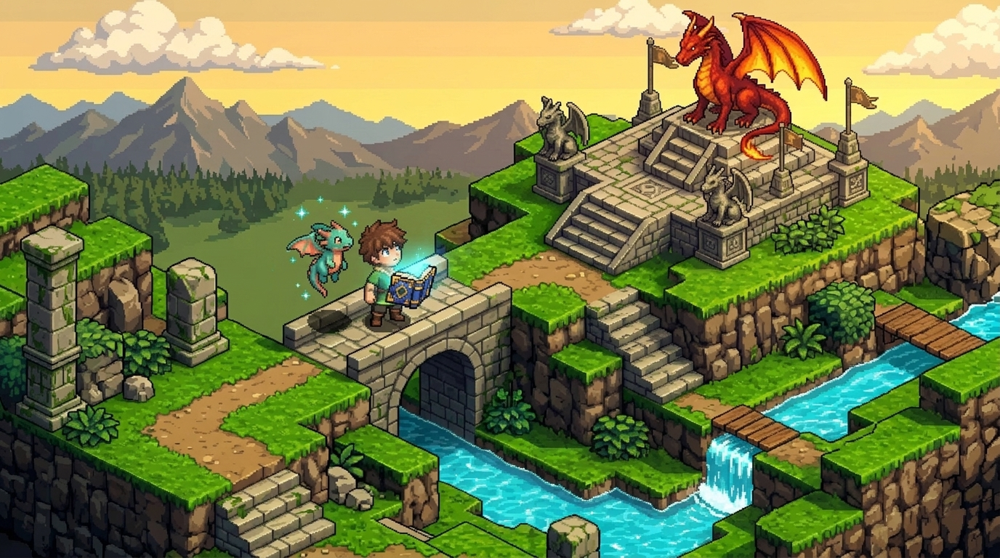 | 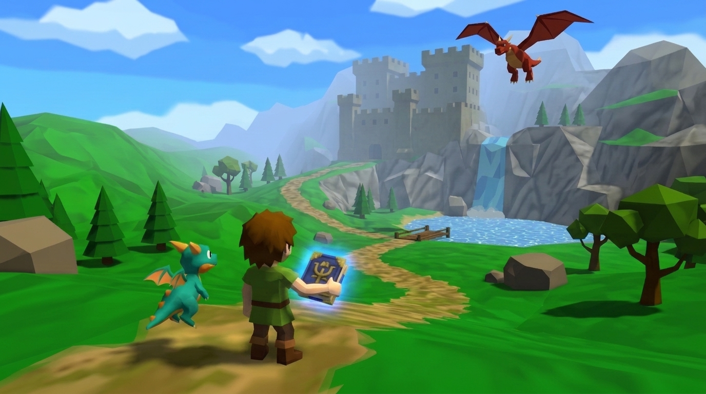 |

| 128-Bit GameCube/PS2 *(Planned)* | HD Era *(Planned)* | Modern / 4K Sandbox *(Planned)* |
| :---: | :---: | :---: |
| 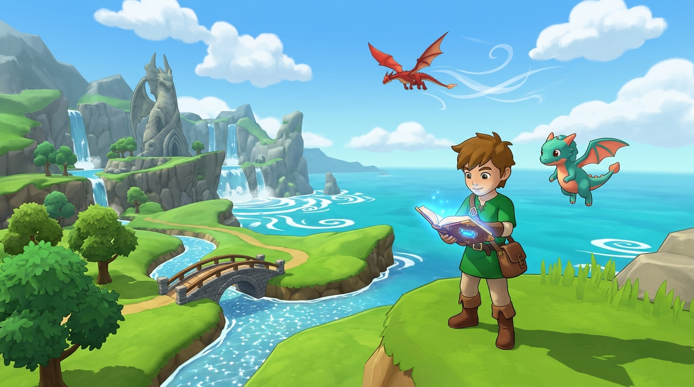 | 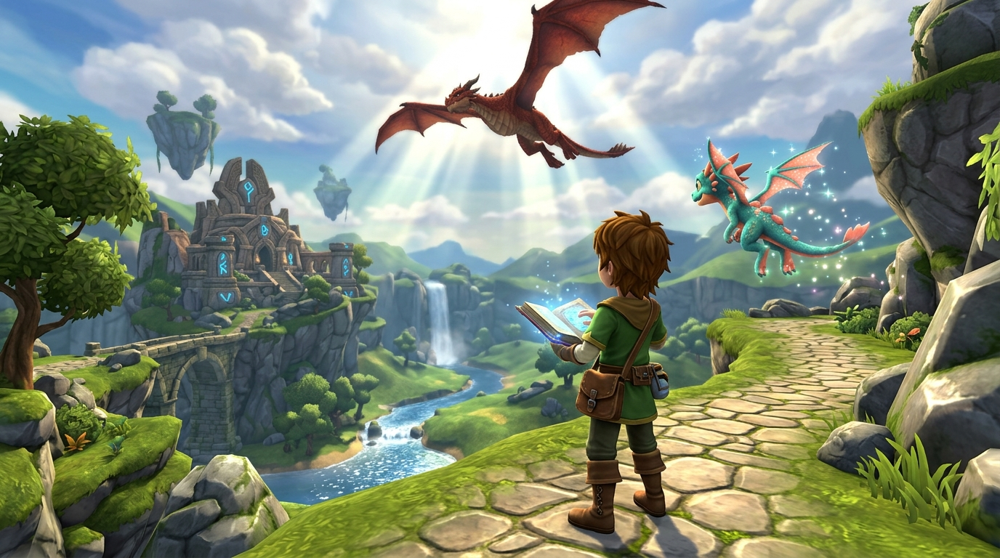 | 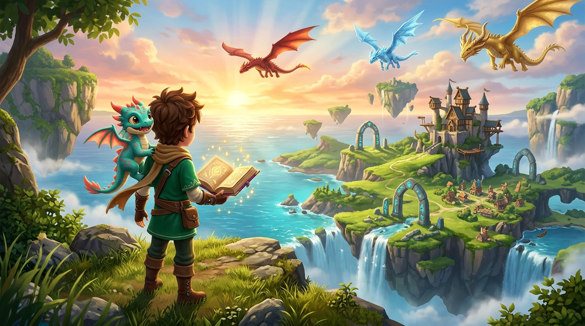 |

---

## Core Mechanics & Kid-Friendly UX

- **Visual-First Hero Forge (with Python Toggle)**: Pick your hero's name, skin, hair, and tunic visually—or flip on **Advanced Python Mode** to run `set_name()`, `preview_skin()`, `preview_hair()`, `preview_tunic()`, and `confirm_hero()`.
- **Kid-Friendly Python Editor**: Line-number gutters, inline red highlighting on syntax/runtime error lines, automatic 4-space indentation after `:`, plain-English **Quick Symbol Buttons** (`⇥ Indent`, `( )`, `" "`, `:`, `==`), IDE autocomplete, `#` comment callouts in early realms, and automatic draft saving.
- **Bram's Tinkerer Workshop**: Earn **Byte Shards** from Trials and chests, then forge gear by writing Python (`wear_hat("explorer")`, `set_tunic_color("crimson")`, `equip_boots("swift")`, `add_charisma(1)`). Features a **live shard budget bar** and inline over-budget line highlighting right inside the editor.
- **Pip's 3-Tier (+ Secret Tier 4) Help System**: Every Trial includes progressive hints plus warm, plain-English Python error translations.
- **iPad & Touch Ready**: Installable Home Screen PWA with a 360° analog virtual thumbstick and touch-friendly action buttons.
- **Instant Guest Play, Kid-Friendly Hero Codes & Dual-Mode Parent Console**: Players can start playing immediately in guest mode (`localStorage`) with zero sign-up. Kids can upgrade to cloud saves with a memorable **Hero Code** (e.g. `EMBER-DRAGON-4821`)—never needing a parent Google login on their device—while parents sign in with Google at `/console` to monitor real-time progress, tune per-hero difficulty/hints, override trials, and rotate codes. Locally, `/builder` retains full Story/Trial authoring and client-side Pyodide solution testing.

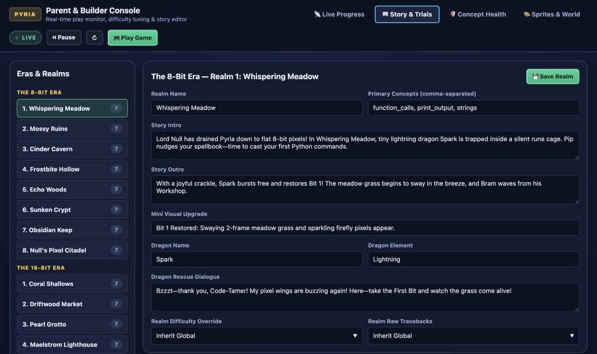

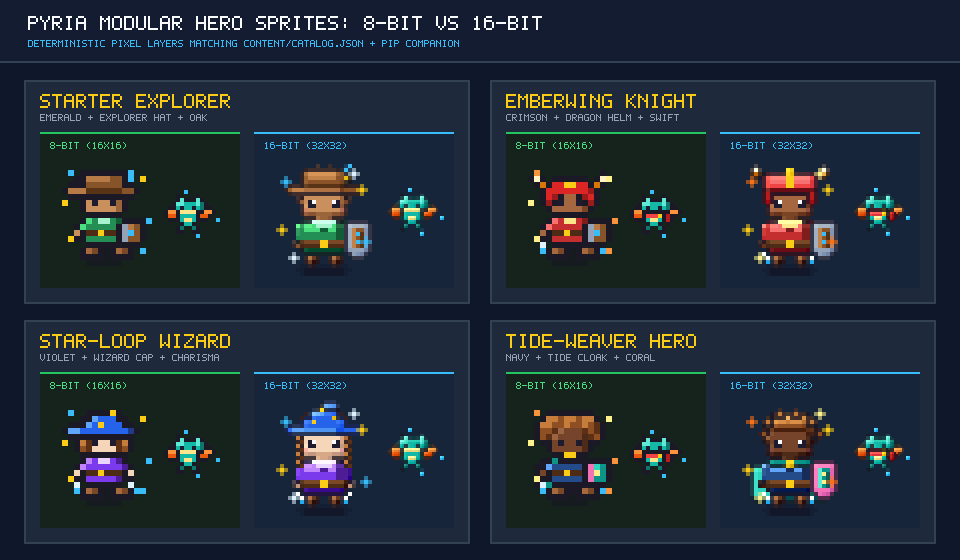

---

## Repository Structure

```text
pyria/
├── docs/              # Game design blueprint & 7-Era architecture docs
├── content/           # Data-driven JSON curriculum, economy & tilemaps
│   ├── game.json              # Metadata, NPCs, 4-era eraOrder & 33-concept progression
│   ├── catalog.json           # Python character creation & Byte Shard unlockables
│   ├── schema.json            # JSON Schema + Python OUTPUT test harness convention
│   ├── eras/                  # era-01-8bit (8R), era-02-16bit (16R), era-03-32bit (6R), era-04-64bit (6R)
│   └── maps/                  # 36 playable 64x48 Realm tilemaps (with 3D elevation layers for 32/64-Bit)
├── assets/            # Visual art, screenshots, pixel-art generators & previewers
│   ├── screenshots/           # Live 8-Bit, 16-Bit, 32-Bit, 64-Bit & /builder screenshots
│   ├── concept-art/           # 7-Era progression renders, 32-Bit biomes & sprite dimension specs
│   ├── sprites/               # Modular 8-bit/16-bit Hero + Pip generator & preview.html
│   ├── tilesets/              # 8-bit/16-bit tilesets + NPC/Dragon sheets
│   └── world/                 # Interactive walkable world previewer & 8-bit/16-bit comparison
├── server/            # Zero-dependency Python 3 + SQLite backend (local dev & elzar deploy)
└── web/               # Playable browser RPG (HTML5 Canvas + 2.5D/3D Renderers + Pyodide) & /builder
```

---

## Quick Start: Local Authoring vs. Public Production

Pyria uses a clean split between **local lesson/world authoring** (Python + SQLite) and **public production hosting** (Cloudflare Workers + Static Assets + D1):

### 1. Local Dev & Content Authoring (`server/app.py` + `/builder`)
Run the zero-dependency Python 3 + SQLite server from the repository root (`--dev` enables local admin access to `/builder` and the HUD Realm Warp):

```bash
python3 server/app.py --host 127.0.0.1 --port 8080 --dev
```

- **Play the Game**: [http://127.0.0.1:8080](http://127.0.0.1:8080)
- **Local Authoring & Builder Console**: [http://127.0.0.1:8080/builder](http://127.0.0.1:8080/builder) *(also accessible at `/console`)*

Edits made in `/builder` (Story & Trials, Concept Health, difficulty overrides) write directly to `content/*.json` in your git working tree. Commit and push to `main` to deploy updated curriculum to production without affecting live D1 player saves.

### 2. Public Production Deployment (Cloudflare Workers + D1)
In production, Pyria runs on **Cloudflare Workers + Static Assets + D1 (SQLite)** at **$0/mo** on Cloudflare's Free Tier:

- **Gameplay (`/`)**: Unauthenticated visitors play immediately in **Guest Mode** (`localStorage` key `pyria_guest_saves`) with zero D1 writes. Kids can click **Get Hero Code** to upgrade to a D1 cloud save, or **Enter Hero Code** to resume on another device (no Google login ever required on a child's device).
- **Parent & Admin Console (`/console`)**: Parents sign in with Google (`/api/auth/google/start?next=/console`) to view real-time progress, add child heroes, link or rotate Hero Codes, tune per-hero difficulty/hints, and override trials. Local-only `/builder` write tabs are automatically hidden in production.

#### Required Cloudflare Workers Secrets & Variables
Configure these in your Cloudflare Workers project (via `wrangler secret put` or the Cloudflare Dashboard):

| Secret / Variable | Purpose |
| :--- | :--- |
| `PYRIA_SESSION_SECRET` | Random 32+ byte secret used to HMAC-sign `pyria_hero_session` and `pyria_parent_session` cookies |
| `GOOGLE_CLIENT_ID` | Google OAuth 2.0 Web Client ID (authorized redirect URI: `https://<your-domain>/api/auth/google/callback`) |
| `GOOGLE_CLIENT_SECRET` | Google OAuth 2.0 Web Client Secret |
| `PYRIA_ADMIN_EMAILS` | Comma-separated list of admin email addresses (grants All Accounts view & `assign-owner` in `/console`) |

#### D1 Migrations & Deploy
```bash
npm install
npx wrangler d1 migrations apply pyria-db --remote
npm run deploy
```

Pushing to `main` automatically runs tests, bundles static assets, and deploys via GitHub Actions.

### 3. Trial Calibration & Periodic Difficulty Review
Pyria tracks privacy-safe per-trial telemetry (`difficultyMode`, `isPractice`, normalized `errorType`, and elapsed `durationMs`) and rolls up daily aggregates into `trial_stats_daily` so calibration history survives attempt pruning.

- **Trial Calibration Dashboard** (`/builder` locally, and Admin `/console` in Cloudflare production; strictly hidden for non-admin parents):
  - Displays KPIs (Trials with Data, 🔴 Too Hard, 🟡 Too Easy, 🟣 Possible Bug, Overall Median Attempts, Total Overrides) and a sortable table across all 310 trials.
  - Filter by **Era**, **Realm**, **Trial Type**, **Difficulty** (`explorer` / `standard` / `challenge`), **Time Window** (`7d` / `30d` / `90d` / `all`), optional **Since** date (`YYYY-MM-DD`), **Flag status**, and **Include Practice Replays**, or click **Export CSV** (`format=csv`).
  - Click any trial row to open the **Drill-Down Modal** showing hint-tier breakdown (`tier0`–`tier3`), top failure error types / wrong multiple-choice options, daily trend with a **Before vs. After** cutoff date check, and (in local `/builder`) a direct **Edit Trial** jump into **Story & Trials**.
- **CLI Calibration Report** (`scripts/calibration_report.py`):
  ```bash
  npm run calibration-report
  # Or invoke directly with filters / output options:
  python3 scripts/calibration_report.py --days 30
  ```
  Generates a concise Markdown/CSV summary of the hardest trials, easiest trials, parent overrides / error spikes, and before/after calibration comparisons from local SQLite or production D1 / Admin API.
- **Recommended Review Cadence**:
  - Run a calibration review **monthly** or **after each content push or new player cohort**.
  - Prioritize 🟣 **Possible Bug** and 🔴 **Too Hard** trials (high Tier-3 hint usage, elevated parent overrides, or `AssertionError` spikes), then check 🟡 **Too Easy** trials.
  - Adjust prompts, starter code, hints, or tests in local `/builder`, commit & push to `main`, and compare before vs. after using the drill-down **Cutoff Date** (with **Since** cleared and a wide enough Time Window) 2–4 weeks later.

### 4. Run Tests
```bash
python3 -m unittest discover -s server -v
node --test web/js/pyRunner.test.mjs
```

---

## Documentation

- [Game Design Blueprint](docs/game_design_blueprint.md) — Narrative arc, 7-Era visual roadmap, curriculum cadence, and economy
- [Concept Art & Sprite Specs](assets/concept-art/README.md) — Visual targets, 8-bit/16-bit sprite specs, and modular Z-layer order
- [Server & Deployment Guide](server/README.md) — Local server options, SQLite save API, security hardening, tests, and `elzar` deployment
