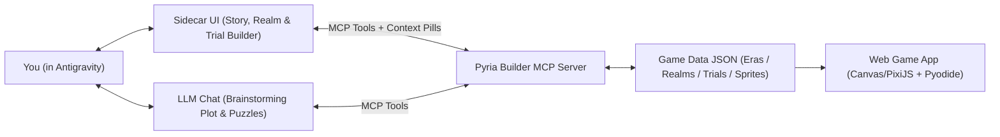

# Python Dragon RPG — Design Blueprint (v2)

> [!NOTE]
> Updated with our locked-in architecture and design decisions. This is our living blueprint as we move toward building the Antigravity sidecar builder, concept art, and modular hero sprites.

---

## 1. Locked-In Architecture & Terminology

* **Repository**: `~/src/pyria` (`https://github.com/dknowles2/pyria`)
* **Hosting & State**: Hosted on **`elzar`** (Debian 13, Python 3 available, 23 GB free) using a lightweight **Python 3 + SQLite** server to serve the web app and persist save progress, Byte Shards, hint history, and parent difficulty overrides (fronted by a Cloudflare tunnel later).
* **Game Runtime**: **Web App** — HTML5 Canvas / PixiJS (for 8-bit & 16-bit 2D) seamlessly transitioning to Three.js (for 3D eras), running real CPython safely in the browser via **Pyodide** (WebAssembly) with execution-step/timeout protection.
* **Data Format**: **Engine-agnostic JSON** files in `content/` for all Eras, Realms, Trials, NPCs, items, and dialogue.
* **Hierarchy**: **`Era` → `Realm` → `Trial`**
  * **Era**: Video game generation and visual style (*8-Bit*, *16-Bit*, *32-Bit / Low-Poly 3D*, etc.).
  * **Realm**: A themed chapter/region (overworld + dungeon). **Each Era has `N` Realms matching its bit count** (8 Realms in 8-Bit, 16 Realms in 16-Bit; we'll revisit the count when we reach 32-bit/64-bit).
  * **Trial**: An individual Python coding puzzle inside a Realm.
* **Management Tooling**: An **Antigravity Sidecar (MCP App)** that lives right in the Antigravity side pane so you can manage Eras, Realms, Trials, and difficulty overrides *while* brainstorming plot twists and puzzles directly with an LLM.

---

## 2. Story Premise & Dragon Progression

### Premise: *The Shattering of Pyria* (working title)
The world of **Pyria** was once vibrant and full of dragons—until **Lord Null** scrambled the world's source code. His *Glitch Storm* flattened reality down to 8-bit pixels and locked the Great Dragons inside **Logic Vaults**.

Your son plays a young **Code-Tamer** armed with a Python Spellbook.
* **1 Dragon per Realm**: Every Realm culminates in rescuing a unique Dragon Guardian.
* **Mini-Upgrades Along the Way**: Each rescued dragon restores **1 Bit** of reality—unlocking a visible upgrade right away (richer palette tones, animated water, new music layers, weather, new traversal powers) and joining the hero's Dragon Camp.
* **Era Upgrade**: Rescuing **all `N` Dragons** in an Era (all 8 in the 8-Bit Era, all 16 in the 16-Bit Era) unites their power and upgrades the entire game to the next graphical Era!

---

## 3. Character Creation (First 2 Minutes — Powered by Python!)

Right from the opening screen, your son uses real Python function calls to preview and build his hero live on screen:

```python
set_name("Kai")
preview_skin("warm")
preview_hair("spiky")
preview_tunic("emerald")
confirm_hero()
```

* A visual **Starter Spellbook** beside the terminal shows the available options (`"spiky"`, `"curly"`, `"hooded"`, etc.) with one-click syntax hints so a Day-1 beginner can experiment playfully and see his sprite change instantly on every run.

---

## 4. Code-Based Customization & Trade-Off Economy

Instead of clicking a shop button with generic gold, your son collects **Byte Shards** (earned from solving Trials, finding hidden dungeon chests, and optional bonus challenges).

In **Bram's Workshop** (or the Hero Terminal), he spends Byte Shards **by writing Python** to unlock and equip gear or boost stats—forcing fun RPG trade-offs (*"Do I spend 30 Shards on `wear_hat("dragon_helm")` now, or save 50 Shards for `equip_boots("swift")`?"*):

```python
# Era 1 (8-Bit) — Calling functions with Shard costs
wear_hat("explorer")        # costs 15 Byte Shards
set_tunic_color("emerald")  # costs 10 Byte Shards
add_charisma(1)             # costs 25 Byte Shards

# Era 2 (16-Bit) — Lists, dictionaries & budget logic
if byte_shards >= 50:
    equip_cape("tide_cloak")
dragon_gear["Emberwing"]["accessory"] = "goggles"
```

Visually, the hero uses **modular layered sprites** (Base Body + Hair + Tunic + Hat + Cape + Held Item) so every code call updates his character immediately.

---

## 5. Era 1: The 8-Bit Era — *"The Flatlands of Pixels"* (8 Realms, 8 Dragons)

*Visual vibe: Classic NES Zelda top-down dungeon crawler. Each rescued Dragon restores 1 Bit of the 8-Bit world.*

| # | Realm | Dragon to Rescue | Python Focus | Mini World / Visual Upgrade |
| :-: | :--- | :--- | :--- | :--- |
| **1** | **Whispering Meadow** | **Spark** *(Ember Hatchling)* | Function calls (`move()`, `open_gate()`), `print()`, strings | Campfire glow & warm grass tones |
| **2** | **Mossy Ruins** | **Pebble** *(Stone Drake)* | Variables (strings & ints), basic math (`+`, `-`, `*`) | Textured stone tiles & dungeon torches |
| **3** | **Cinder Cavern** | **Emberwing** *(Flame Dragon)* | Booleans (`True`/`False`), comparisons (`==`, `>`, `<`), basic `if` | Flickering lava & dynamic torchlight |
| **4** | **Frostbite Hollow** | **Glacier** *(Ice Wyvern)* | `if / elif / else` branching paths | Shimmering ice tiles & snowfall particles |
| **5** | **Echo Woods** | **Bramble** *(Forest Dragon)* | Logical operators (`and`, `or`, `not`) & string methods (`.lower()`, `.upper()`) | Animated swaying trees & forest ambience |
| **6** | **Sunken Crypt** | **Mire** *(Swamp Dragon)* | Combining variables + math + multi-branch conditionals | Rippling water tiles & mist |
| **7** | **Obsidian Keep** | **Gale** *(Wind Dragon)* | Intro to simple `for` loops (`for i in range(4):`) | Moving clouds & floating platforms |
| **8** | **Null's Pixel Citadel** | **Nova** *(Starlight Dragon)* | 8-Bit Boss Gauntlet (integrating all Era 1 concepts—no trivial drills!) | **All 8 Bits Restored → World Upgrades to 16-Bit!** |

---

## 6. Era 2: The 16-Bit Era — *"The Sunken Isles & Beyond"* (16 Realms, 16 Dragons)

*Visual vibe: SNES Zelda: A Link to the Past / Chrono Trigger. Organized into **4 Acts of 4 Realms each** (16 Realms total), so the story stays cohesive and we can build it act-by-act ahead of his pace.*

* **Act I — Tideglass Archipelago (Realms 1–4, Dragons 1–4)**
  * *Focus*: `for` loops, `range()`, `while` loops (with safe loop-limit guards), and **Lists** (indexing, `.append()`, iterating over inventory & dragon treats).
* **Act II — The Clockwork Spire (Realms 5–8, Dragons 5–8)**
  * *Focus*: Writing your own **Functions** (`def`), parameters, default arguments, and `return` values (building reusable spells & custom character abilities).
* **Act III — The Alchemist's Caldera (Realms 9–12, Dragons 9–12)**
  * *Focus*: **Dictionaries**, nested data (lists of dicts for crafting potions, dragon stats, and quest logs), string formatting (`f"..."`), and reading real Python tracebacks.
* **Act IV — The Shattered Skyway (Realms 13–16, Dragons 13–16)**
  * *Focus*: Intro to **Classes & Objects** (customizing dragon companions & mounts), multi-step algorithmic dungeon puzzles, and the 16-Bit Finale → **Unlocks Era 3 (3D)!**

---

## 7. Cast of Characters (NPCs)

* **Pip (Glitch Hatchling & Sidekick)**: Follows the hero everywhere; serves as the **3-tier Help System** and comic relief.
* **Elder Ada (The Archivist)**: Keeper of the Spellbook; introduces new Python concepts and tracks rescued dragons.
* **Bram the Tinkerer (The Attribute Smith)**: Runs the Camp Workshop where Byte Shards + Python calls customize the hero and dragons.
* **The Rescued Dragons**: Join the hero's Dragon Camp, unlock traversal perks, and visibly upgrade the world.
* **Lord Null & The Syntax Gremlins**: Playful, Saturday-morning-cartoon villains who scramble signs, break bridges, and lock up dragons.

---

## 8. Built-In Help System & Progressive Tracebacks

Every Trial has a **3-tier "Ask Pip" system**:
1. **Tier 1 — Gentle Nudge**: Plain-English conceptual hint.
2. **Tier 2 — Pattern / Fill-in-the-Blank**: Similar example or skeleton with blanks.
3. **Tier 3 — Guided Walkthrough**: Step-by-step explanation or working snippet.

**Progressive Error / Traceback Learning**:
* **Early Realms**: Pip translates errors into friendly speech bubbles (*"Oops! Python expects a `:` at the end of an `if` line!"*) with the real error tucked underneath.
* **Later Realms**: Pip gradually steps back so your son learns to read real Python tracebacks directly (with a parent override toggle in the sidecar).

---

## 9. Antigravity Sidecar: The Game Builder (MCP App)

We'll build the management tool first as a local **Antigravity MCP App plugin** (`~/.gemini/config/plugins/pyria-builder/`) that opens right in the **Antigravity side pane** (`aux_pane`) or full-page sidebar (`global`):



What this unlocks:
* **Live Co-Design with the LLM**: Select any Realm or Trial in the sidecar and click **"Attach to Chat"** (`updateModelContext`) to brainstorm dialogue, puzzle twists, or dragon personalities with the model—and let the model write approved edits straight back into the JSON via MCP tools.
* **Story & Realm Manager**: Browse all 8 Realms (8-Bit) and 16 Realms (16-Bit), edit story beats, dragons, and NPCs.
* **Trial Authoring & Live Python Tester**: Add/edit/reorder Trials, starter code, Byte Shard rewards, 3-tier Pip hints, and test assertions.
* **Anti-Repetition Concept Tracker**: Tags every Trial with Python concepts and flags when higher Realms repeat overly basic concepts.
* **Parent Difficulty Override**: Override difficulty globally, per Realm, or per Trial (starter scaffolding, hint strictness, and traceback visibility).
